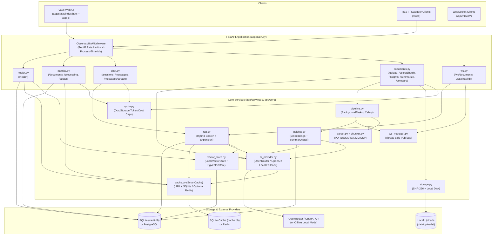

# 1. System & Component Architecture

High-level view of how **Vault AI** connects the Web UI, FastAPI routers, middleware, services, workers, and local/optional storage backends.

## Key Design Points
- **Local-First Defaults:** Runs out-of-the-box on SQLite, local disk (`data/uploads/`), `LocalVectorStore`, `SmartCache (memory+sqlite)`, and FastAPI `BackgroundTasks`.
- **Optional Scale-Out:** Switching `DATABASE_URL` to PostgreSQL activates `PgVectorStore`, setting `REDIS_URL` activates Redis caching, and `USE_CELERY=true` delegates ingestion to Celery workers.
- **Cross-Cutting Guards:** `ObservabilityMiddleware` enforces per-IP rate limits (`120 req/min`) and records HTTP latency; `quota.py` enforces document count, storage, and daily AI token/cost caps.
