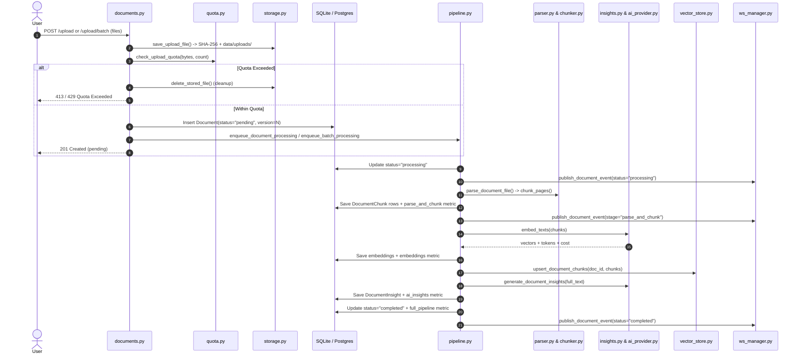

# 2. Document Ingestion Pipeline (Single & Batch)

End-to-end asynchronous flow from file upload (`POST /api/v1/documents/upload` or `/upload/batch`) through parsing, chunking, embedding, vector indexing, AI insights, and live WebSocket status broadcasts.

## Notes
- **Batch Processing:** `POST /api/v1/documents/upload/batch` validates the entire batch against `max_documents` and `max_total_storage_mb` before committing, cleans up all temporary files on failure, and records a `batch_pipeline` metric.
- **Live UI Updates:** The Web UI connects to `WS /api/v1/ws/documents` and auto-refreshes the document list when `completed` or `failed` events arrive.
