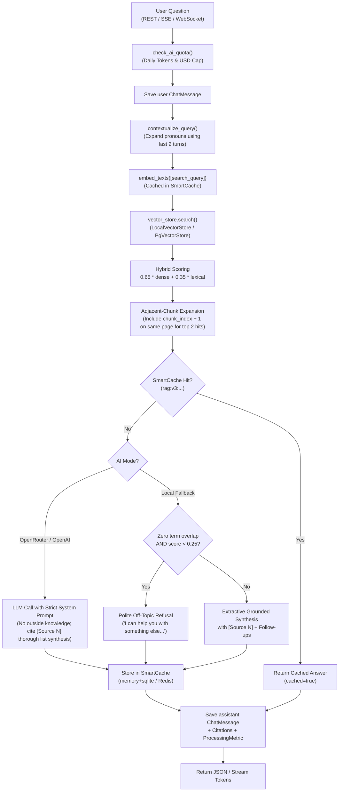

# 3. Conversational RAG & Strict Grounding Flow

How `POST /api/v1/chat/sessions/{id}/messages`, SSE `/messages/stream`, and `WS /api/v1/ws/chat/{id}` retrieve context, prevent hallucinations/off-topic answers, and return `[Source N]` citations.

## Guardrails Built Into This Flow
1. **Strict Document-Only Grounding:** `RAG_CHAT_SYSTEM_PROMPT` forbids pretraining knowledge (e.g., general trivia or writing unrelated code) and returns a polite refusal offering help with uploaded documents instead.
2. **Adjacent-Chunk Expansion:** Multi-chunk sections (such as `Bonus Points` spanning two chunks on the same page) automatically pull in `chunk_index + 1` so lists aren't truncated.
3. **Pronoun Context Expansion:** Short follow-up questions like *"How long are they retained?"* are enriched with keywords from the last 2 user turns before retrieval.
