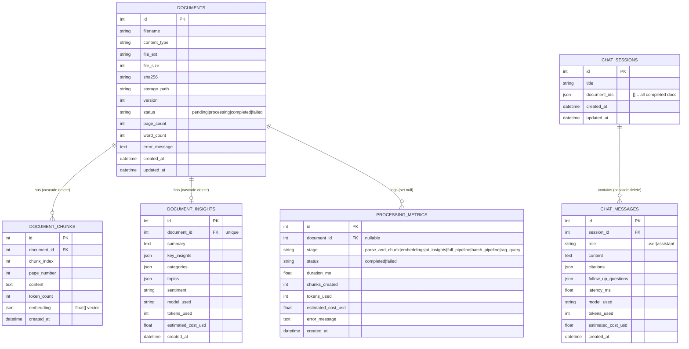

# 4. Data Model & Entity-Relationship (ER) Diagram

SQLAlchemy 2.0 schema defined in `app/db/models.py` (works identically on SQLite locally and PostgreSQL in production).

## Notes
- **Document Versioning:** Re-uploading a file with the same `filename` increments `version` automatically while retaining history.
- **Multi-Doc Chat Scope:** `chat_sessions.document_ids` stores a JSON list of document IDs (`[]` means vault-wide across all `completed` documents).
- **Separate Cache Store:** `SmartCache` persists entries in `data/cache.db` (`cache_entries` table) or Redis rather than the primary application DB.
