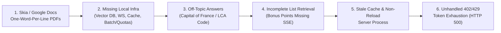

# 5. Issues Encountered & How They Were Fixed

A chronological log of real issues uncovered during development and testing—including root causes, fixes, and verification.

---

### Issue 1: PDFs Exported with One Word Per Line (Skia / Google Docs)
- **Symptom:** Uploading `AI-Powered Vault Document System_  Case Study.pdf` produced extracted text with almost every word on its own line and `\ufffd` bullet artifacts, breaking sentence chunking and retrieval quality.
- **Root Cause:** `pypdf` extracts Skia/Google Docs PDFs with line breaks between individual words (`avg_words < 1.8` per line).
- **Fix (`app/services/parser.py`):** Added a heuristic in `_extract_pdf_pages` that detects low words-per-line PDFs (`len(non_empty_lines) > 25` and `avg_words < 1.8`), rejoins lines into prose, normalizes `\ufffd` bullets to `\n- `, and restores numbered list breaks.
- **Verification:** Verified clean extraction and chunking in `scripts/demo.py` (`4 pages, 10 chunks`).

---

### Issue 2: Case Study Bonus & Production Features Only Stubbed Locally
- **Symptom:** Comparing the repo against the Case Study PDF showed four gaps: in-memory JSON scanning instead of a vector store, no WebSockets, memory-only cache (no persistence/Redis), and no batch upload or quota management.
- **Root Cause:** Infrastructure placeholders (`docker-compose.yml` pgvector/redis, `REDIS_URL`) existed without runtime implementations that worked locally.
- **Fix (4-Phase Local-First Implementation):**
  1. **Vector Store (`app/services/vector_store.py`):** Added `LocalVectorStore` (thread-safe normalized index with lazy SQLite hydration) and `PgVectorStore` (PostgreSQL `pgvector` with fallback).
  2. **WebSockets (`app/services/ws_manager.py`, `app/api/v1/ws.py`, `app/static/app.js`):** Added live status streaming (`/ws/documents`, `/ws/documents/{id}`) and chat streaming (`/ws/chat/{session_id}`).
  3. **Persistent Cache (`app/core/cache.py`):** Upgraded `SmartCache` to `memory+sqlite` (`data/cache.db`) with optional Redis backing and automatic fallback.
  4. **Batch & Quotas (`app/services/quota.py`, `app/api/v1/documents.py`, `app/static/index.html`):** Added multi-file upload (`/upload/batch` + `<input multiple>` in UI), `process_batch_pipeline`, daily token/USD and storage/doc-count quotas, and `GET /api/v1/metrics/quotas`.
- **Verification:** Added dedicated test suites (`test_vector_store.py`, `test_websockets.py`, `test_cache.py`, `test_batch_and_quotas.py`); all 31 tests passed.

---

### Issue 3: Assistant Answering Off-Topic Questions Outside Uploaded Docs
- **Symptom:** Asking *"What is the capital of France?"* returned *"The provided context does not contain information... However, the capital of France is Paris."* Asking *"Can you write code for LCA"* generated LCA code instead of declining.
- **Root Cause:**
  1. `RAG_CHAT_SYSTEM_PROMPT` only said *"state what is missing instead of guessing"*—it did not forbid using pretraining knowledge or writing code.
  2. In local fallback mode, `retrieve_relevant_chunks` fell back to returning unrelated chunks when lexical overlap was `0`, and `generate_grounded_rag_answer` still synthesized sentences from them.
- **Fix:**
  - Updated `RAG_CHAT_SYSTEM_PROMPT` (`app/services/prompts.py`) to strictly prohibit outside/pretraining knowledge, external facts (*"However, ..."*), and ungrounded code generation, instructing it to reply politely that the topic isn't in the uploaded documents and offer help with something else in the vault.
  - Added a zero-overlap + low-score (`< 0.25`) refusal guard in local synthesis (`app/services/ai_provider.py`).
- **Verification:** Added `test_off_topic_questions_are_declined_without_outside_knowledge` in `tests/test_chat_rag.py` and verified live against `openai/gpt-4o`.

---

### Issue 4: Incomplete Answers for Multi-Chunk Sections (e.g., "Bonus Points" Missing SSE)
- **Symptom:** Asking *"what was asked to implement to get bonus points?"* listed only `Advanced AI Features` and omitted `Technical Excellence` (including SSE/WebSocket) and `Production Readiness`.
- **Root Cause:** Page 4 of the Case Study PDF spanned `chunk_index=8` and `chunk_index=9`. Because `chunk_index=9` lacked the literal words `"bonus points"`, it wasn't retrieved in the top `k` chunks, and the prompt didn't explicitly instruct the LLM to synthesize all categories across excerpts.
- **Fix:**
  - Added **adjacent-chunk expansion** in `retrieve_relevant_chunks` (`app/services/rag.py`) so the top 2 hits automatically pull in `chunk_index + 1` on the same `document_id` and `page_number` right after each hit.
  - Updated `RAG_CHAT_SYSTEM_PROMPT` (`app/services/prompts.py`) to require thorough synthesis across all matching categories/items when asked for lists.
- **Verification:** Added `test_multi_chunk_section_expands_adjacent_chunk` in `tests/test_chat_rag.py`; all 33 tests passed.

---

### Issue 5: Stale Persistent Cache & Server Running Without `--reload`
- **Symptom:** After updating prompts and retrieval logic, live HTTP calls to `127.0.0.1:8000` still returned old pre-fix answers, and a fresh `uvicorn` launch hit `[WinError 10048]` (port 8000 already bound).
- **Root Cause:**
  1. `SmartCache` (`data/cache.db`) persisted pre-fix answers under `rag:...` across requests.
  2. An earlier `uvicorn` process (PID `8188`) was running without `--reload`, serving stale code from memory.
- **Fix:**
  - Versioned the RAG cache namespace (`rag:v2` → `rag:v3`) in `app/services/ai_provider.py` whenever grounding/retrieval semantics change.
  - Stopped the stale process and restarted `uvicorn app.main:app --reload --host 127.0.0.1 --port 8000`.
- **Verification:** Verified `/api/v1/health` returned fresh `uptime_seconds` and updated capabilities.

---

### Issue 6: Upstream AI Token/Credit Exhaustion Returning Generic HTTP 500
- **Symptom:** Asking *"can you give summary of all paragraphs"* in the chat UI displayed `Error: Internal Server Error` instead of explaining that the AI provider's token/credit limit was reached.
- **Root Cause:** `openai.APIStatusError` (HTTP `402` from OpenRouter for insufficient credits, or `429` rate/token limits) was uncaught in `app/services/ai_provider.py`, causing FastAPI to emit an unhandled `500 Internal Server Error`.
- **Fix:**
  - Added `AIProviderError` and `_call_provider()` in `app/services/ai_provider.py` wrapping all `embeddings.create` and `chat.completions.create` calls.
  - Mapped `402`/`429` and credit/token/quota errors to a clear message: *"You exhausted your token limits or credits with the AI provider. Please add credits or switch to local mode."*
  - Registered a global `@application.exception_handler(AIProviderError)` in `app/main.py` and handled `AIProviderError` in `app/api/v1/ws.py` so both REST and WebSocket clients receive the structured error detail.
- **Verification:** Added `test_provider_token_exhaustion_returns_clear_error` in `tests/test_llm_provider.py`; all 34 tests passed.
